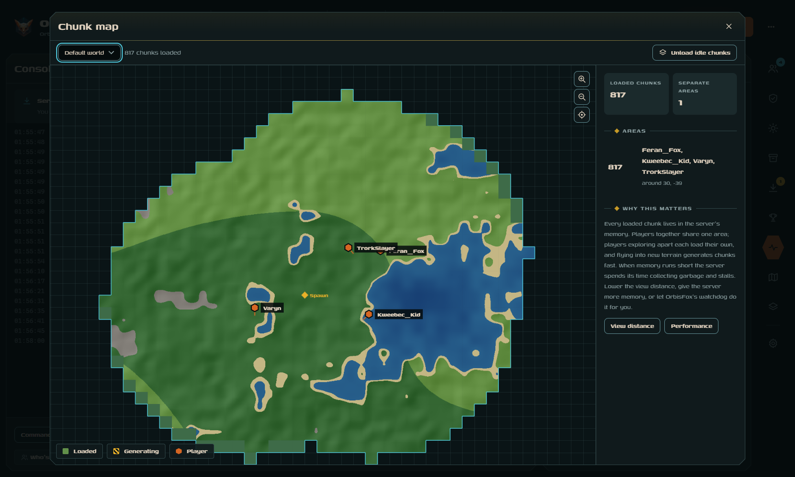
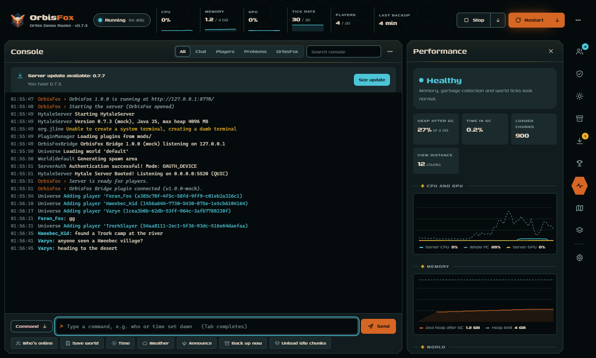

<p align="center"></p>

<h1 align="center">OrbisFox</h1>

<p align="center"><b>A modern control panel for Hytale dedicated servers.</b><br>
Live console, one-click restarts, backups, updates, whitelist and operators, player pings and stats,
a live map of loaded chunks, and a watchdog that rescues a server bogged down by too many loaded chunks.</p>

<p align="center"></p>

OrbisFox replaces the bare terminal window your Hytale server runs in. It starts the server
itself, so the console stays front and centre, but everything around it is a click away. Closing
the window does not stop the server; it keeps running until you stop it. You can open the panel
again from the desktop shortcut, or from your phone if you turn on network access.

No extra packages are needed: OrbisFox is plain Python. It works on Windows (with a native
app window) and on Linux (open it in a browser).

## Features

**Console**
- Live, colour-coded server output with filters (chat, players, problems) and search
- Command line with autocomplete for every vanilla command and player name, plus history
- Send as **Say** (chat), **Notice** (on-screen) or **Title** (big title on every screen)
- Quick buttons: who's online, save world, time of day, weather, announce, back up, unload idle chunks

**Server control**
- Start, stop and **restart** without closing the window, optionally after warning players (1 or 5 minutes)
- Force stop for a hung server; automatic restart after a crash (with crash-loop protection)
- Daily scheduled restarts with countdown warnings
- Signs the server in to Hytale: shows the device code to enter when the server asks

**Players**
- Online players with **ping**, world, position and session time
- Kick, ban, unban, operator, whitelist, game mode, teleport, give item, locate
- **Stats**: playtime, sessions, **distance walked, deaths, mobs killed, PvP kills**, with a leaderboard
  and a sortable full table, plus a feed of recent deaths and kills

**Access**
- Whitelist on or off, add and remove players; operators; bans with reasons

**World**
- Day/night dial: dawn, midday, dusk, midnight, pause time
- Weather; view distance and player limit **live**; server name, message of the day, password, game mode

**Backups**
- One-click backup of the world, player data, server settings and (optionally) mods, saved first
  so the copy is consistent
- **Last backup** always visible in the top bar; automatic backups every N minutes; keep the newest N
- Restore with a safety backup made first; download any backup
- Also lists the server's own built-in backups (`--backup`)

**Updates**
- Checks Hytale's update channel and shows when a new server version is out
- **Installs it for you:** backs up, warns players, applies the update, restarts. It uses the server's
  built-in updater when the server is running, or Hytale's official downloader when it is stopped.
  Your world, settings and mods are never touched.
- Release or pre-release channel; optional automatic install when nobody is online

**Performance**
- CPU, GPU and memory of the server process and of the whole PC; Java heap after garbage collection;
  time spent in GC; tick rate per world; loaded chunks
- Plain-language suggestions with an **Apply** button (memory size, view distance, safety options)
- **Watchdog** for the "too many chunks" freeze (see below)

**Chunk map**
- Every loaded chunk, drawn with the server's own map imagery, grouped into separate areas, with
  players, spawn, and chunks still generating. Pan and zoom.

**Also**
- Mods: list, enable and disable; past server logs viewer
- Open the panel from other devices on your network, behind a password
- Starts with Windows (optional), desktop and Start menu shortcuts

## The "too many chunks" freeze

When players spread out and explore, the server can grind to a halt until it is restarted. That
happens because every loaded chunk lives in the server's memory. Once memory is nearly full, Java
spends its time collecting garbage instead of running the world.

OrbisFox watches for it: memory after garbage collection, time spent paused, the server's own
slow-tick warnings, and with the plugin, whether each world thread is still responding. When it
finds trouble it steps in gently, in this order:

1. Lowers the view distance while memory is tight, then raises it back once things are calm.
2. Asks the server to unload chunks nobody needs.
3. Warns players and restarts, if nothing else helps.

The full explanation, with what Hytale itself has fixed so far, is in
**[docs/chunk-freeze.md](docs/chunk-freeze.md)**.

<p align="center">
</p>

## Getting started (Windows)

1. **Install Python 3.10 or newer** from https://www.python.org/downloads/ and tick *Add python.exe
   to PATH*. Your server PC already has Java 25 for Hytale; OrbisFox finds it.
2. **Download OrbisFox.** Use *Code → Download ZIP* on GitHub and unzip it somewhere permanent, such
   as `C:\OrbisFox`, or `git clone` it.
3. Run **`Install.bat`** to add desktop and Start menu shortcuts, then open **OrbisFox**.
4. Pick your server folder: the one that holds `HytaleServer.jar` (the `Server` folder of the
   official download). **Close the old server window (start.bat) first**, then press **Start**.
5. Optional: open *Mods and logs* and press **Install plugin** to add the OrbisFox Bridge plugin,
   then restart the server.

The first time the server starts, it may ask to be signed in to Hytale. OrbisFox shows the link and
the code; afterwards press *Remember sign-in* so it stays signed in across restarts.

Want to look around first? Run **`Demo.bat`**. It starts OrbisFox with a pretend server, made-up
players and a fake map, in a separate data folder. Type `stress` in its console to watch the
watchdog deal with a chunk overload, and `calm` to end it.

### Linux

```sh
python3 -m orbisfox --background      # then open http://127.0.0.1:8765 in a browser
```

Run it under `systemd` or `tmux` to keep it going after you log out.

## The OrbisFox Bridge plugin

The server console doesn't show pings, kills, distance walked, tick rates, or which chunks are
loaded. The small **OrbisFox Bridge** plugin (`plugin/`) reports those to OrbisFox over
`127.0.0.1` only, and only when OrbisFox started the server. Each start uses a fresh random token.
Without the plugin, OrbisFox still works; those numbers just show as unavailable, and the chunk map
estimates loaded areas from view distance.

Install it from the panel (*Mods and logs → Install plugin*), or copy `OrbisFoxBridge.jar` from the
latest GitHub release into your server's `mods` folder. To build it yourself, see
[plugin/README.md](plugin/README.md).

## Using the panel from other devices

Settings → *Panel access*: set a password, turn on *Allow other devices on my network*, and restart
OrbisFox. Then browse to `http://<server-PC-IP>:8765` from a phone or another PC.

Do **not** forward the panel's port on your router. For access from outside your home, put it
behind a VPN or a sign-in proxy such as Cloudflare Tunnel with Cloudflare Access.

## Where things are kept

Everything OrbisFox stores lives in its `data` folder, next to the program. That includes its
settings, backups (unless you choose another folder), player stats and its own log. Updating
OrbisFox never touches it. The Hytale server's own files stay where they are.

| | |
|---|---|
| Panel | `http://127.0.0.1:8765` (this PC only, unless you allow your network) |
| Settings | `data/settings.json` |
| Backups | `data/backups/orbisfox-<date>-<reason>.zip` |
| Stats | `data/players.json` |
| GC log | `<server>/logs/orbisfox-gc.log` |

## Troubleshooting

- **"Java was not found" / "needs Java 25":** install Java 25 (for example Eclipse Temurin 25), or
  set its path in Settings.
- **The server starts, but players can't join:** check the notice at the top of the console. The
  server may need to be signed in. Also forward **UDP** port 5520 on your router.
- **"A server from an earlier OrbisFox session is still running":** OrbisFox was closed in a way
  that left the server running without its console. Press *Stop it* to take over.
- **Changing config.json by hand:** stop the server first; it rewrites its settings while running.
  View distance and player limit can be changed live from the World panel.

## Development

```
orbisfox/          Python backend (standard library only)
  core.py          ties everything together; console parsing; scheduler
  server.py        runs the Java process: start, stop, restart, countdowns, exit code 8 updates
  hytale.py        Hytale specifics: log format, files, commands, versions
  watchdog.py      the chunk-freeze watchdog and suggestions
  jvm.py           GC log reader, finding Java
  metrics.py       CPU, memory and GPU (Windows performance counters / Linux /proc)
  backups.py  updates.py  players.py  bridge.py  routes.py  httpd.py  desktop.py
web/               the panel (plain HTML, CSS and ES modules; no build step)
plugin/            OrbisFox Bridge, the Java server plugin
tools/mock_server.py   pretend Hytale server used by the demo and for testing
```

Run from source with `python -m orbisfox` (add `--demo` for the pretend server). The panel talks to
a JSON API under `/api/` and a Server-Sent Events stream at `/api/events`.

## Credits

- Made by AlphaFoxtrot. The UI follows the AlphaFoxtrot design system: fox orange, circuit cyan and
  hexagons on near-black teal, with a Hytale-style chamfered frame.
- [Genos](https://fonts.google.com/specimen/Genos) typeface, SIL Open Font License 1.1 (`web/fonts/OFL.txt`).
- Command, log and file formats come from the official
  [Hytale Server Manual](https://support.hytale.com/hc/en-us/articles/45326769420827-Hytale-Server-Manual)
  and from how existing open-source Hytale panels and plugins use them.

OrbisFox is a fan-made tool. It is not affiliated with or endorsed by Hypixel Studios. Hytale is a
trademark of Hypixel Studios.

## License

The code is released under the MIT License (see [LICENSE](LICENSE)). The AlphaFoxtrot fox artwork
in `assets/` and `web/img/` is © AlphaFoxtrot and may be used only as part of OrbisFox.
